## 1. 지도에 없는 사람과 Nav2

### 시나리오: 길 위에 서 있는 관람객

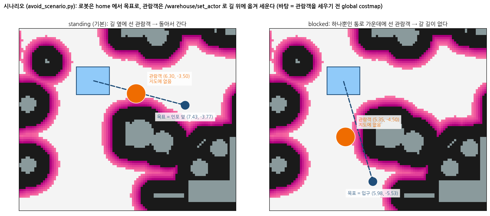{width=1000}

- 부스의 손님 · 직원은 지도에 그려져 있음 → 여기서는 지도에 없는 관람객 한 명을 길 위에 세움
- standing: 길 옆에 선 관람객 · blocked: 하나뿐인 통로 가운데에 선 관람객
- 이 글의 관람객은 서 있기만 함 (걷는 사람은 다루지 않음)

### 회피의 동작 흐름

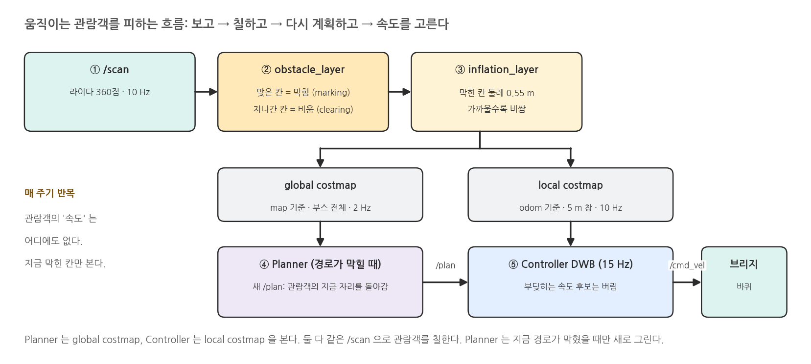{width=1000}

### marking 과 clearing

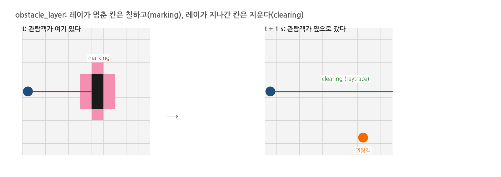{width=1000}

### RViz2 에서 인지 결과 보기

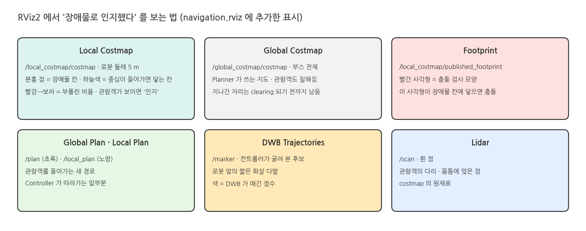{width=1000}

## 2. 실행: 길 옆에 선 관람객 피하기

### 실행: 터미널 1 (nav)

```bash
source /opt/ros/jazzy/setup.bash
source scripts/env.sh
./scripts/robotworld nav moveit:=false actors:=$PWD/src/mobile_openarm_mujoco/worlds/actors_avoid.yaml
```

- `actors_avoid.yaml`: 관람객 한 명(`visitor_standing`)을 부스 밖에 세워 둔 배우 파일 · 기본 실행에는 들어가지 않음
- 배우는 지도(`maps/booth`)에 없고 라이다 · 카메라에만 보임

### 실행 결과: 시작 화면

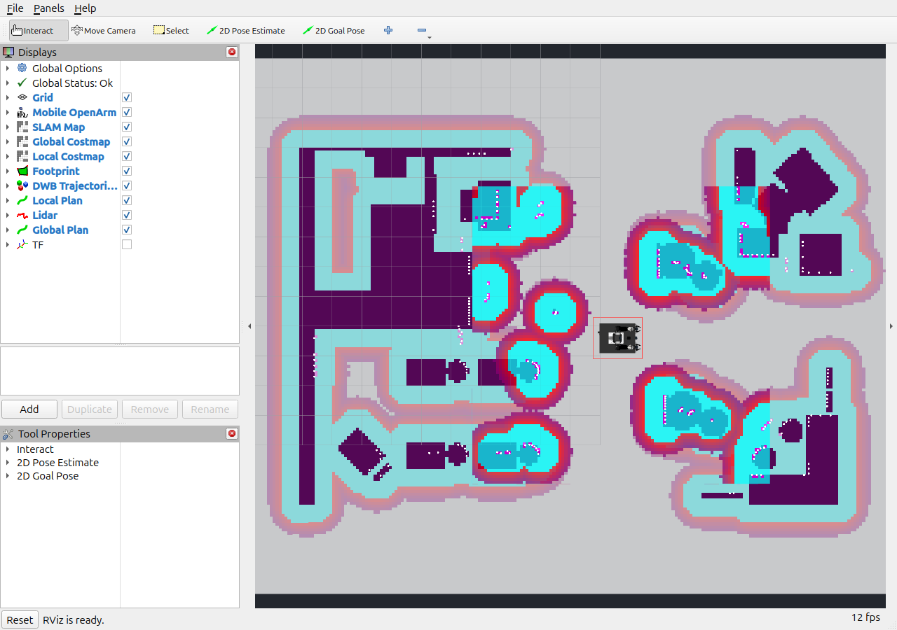{width=1000}

### 터미널 2: 시나리오 실행

```bash
source /opt/ros/jazzy/setup.bash
source scripts/env.sh
python docs/camp/avoid_scenario.py              # 관람객을 (6.30, -3.50) 에 세우고, 로봇은 인포 앞 (7.43, -3.77) 으로
```

### 실행 결과: 시나리오

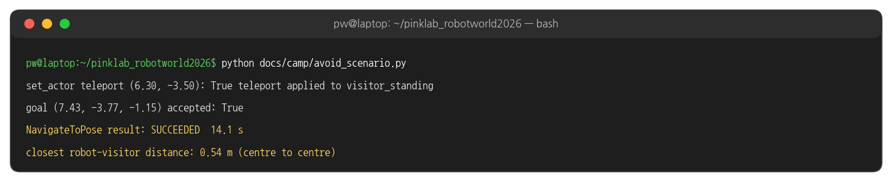{width=1000}

- 14.1 초에 도착 (관람객이 없을 때 약 15 초) · 가장 가까울 때 중심 거리 0.54 m

### 움직이는 그림: 길 옆에 선 관람객 피하기

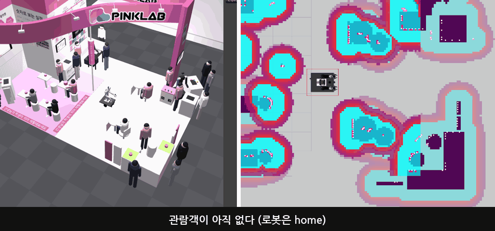{width=970}

### RViz2 로 본 회피 과정

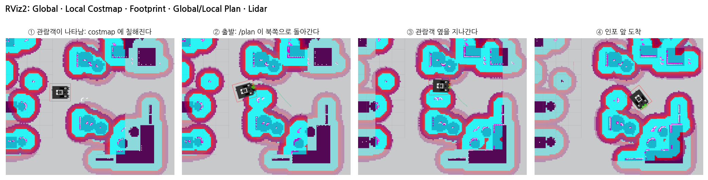{width=1000}

### 같은 순간의 MuJoCo 창

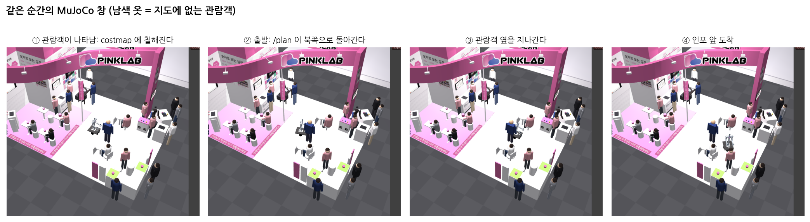{width=1000}

### 실측: local costmap 과 경로

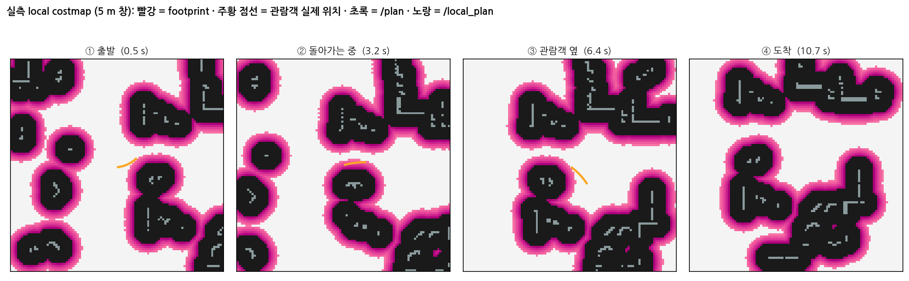{width=1000}

### 실측: 타임라인

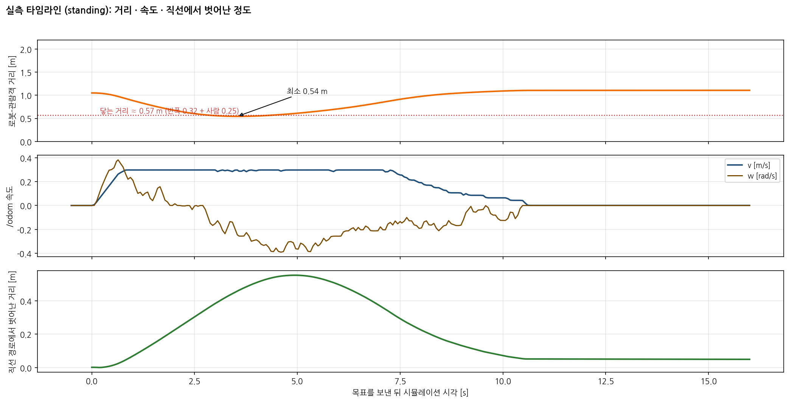{width=1000}

- 최소 거리 0.54 m (3.5 초) · 직선 경로에서 가장 많이 벗어난 거리 0.55 m
- 닿는 거리(약 0.57 m)보다 조금 가까움 → 사람 옆을 바짝 지나간 것 (부딪히지는 않음)

### 실측: 위에서 본 궤적

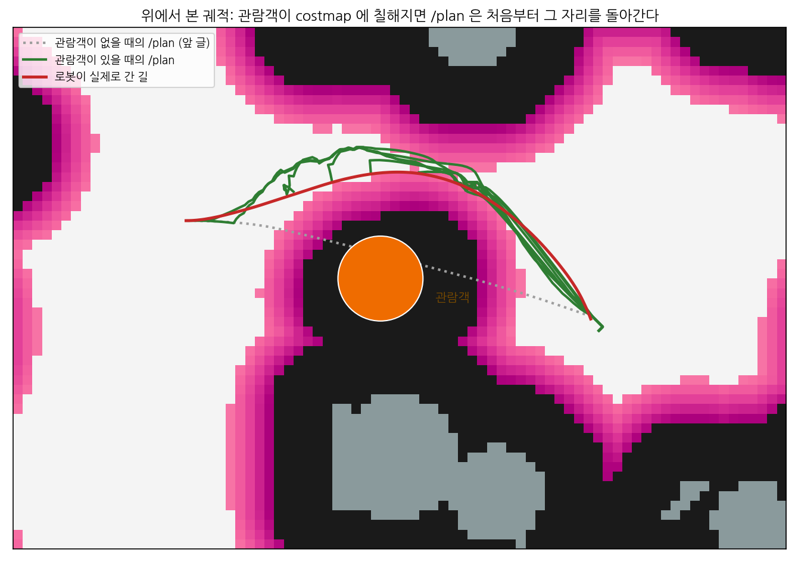{width=1000}

## 3. 한계: 길을 완전히 막은 관람객

### 터미널 2: blocked 시나리오

```bash
python docs/camp/avoid_scenario.py --mode blocked --timeout 90     # 관람객을 통로 가운데 (5.35, -4.50) 에, 목표는 입구
python docs/camp/avoid_scenario.py --mode clear                    # 관람객을 부스 밖으로 보내고 같은 목표 다시
```

### 실행 결과: blocked → clear

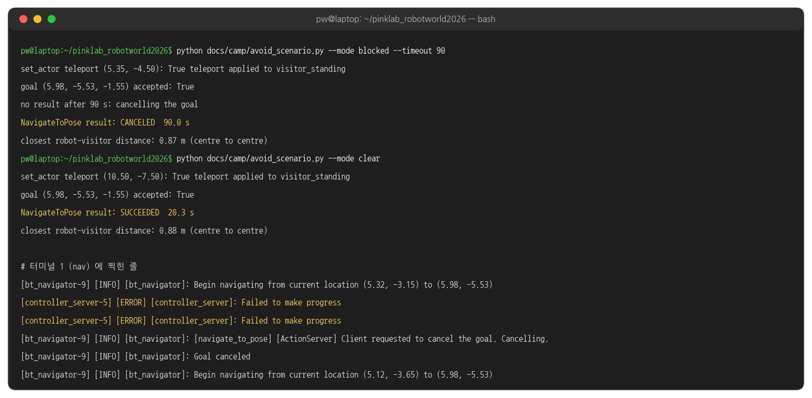{width=1000}

### 움직이는 그림: 길을 완전히 막은 관람객

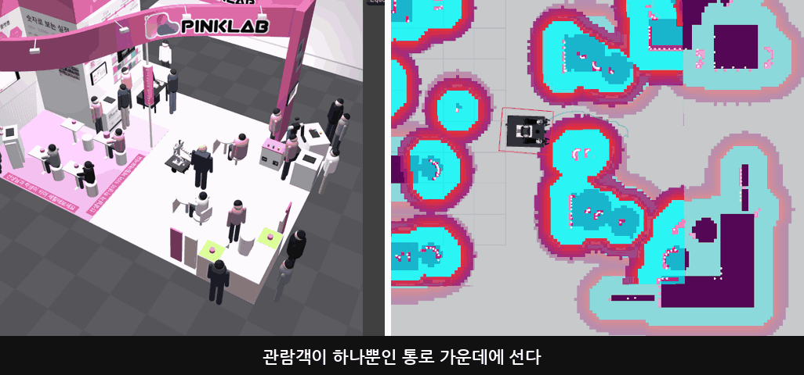{width=970}

### blocked 의 궤적과 거리

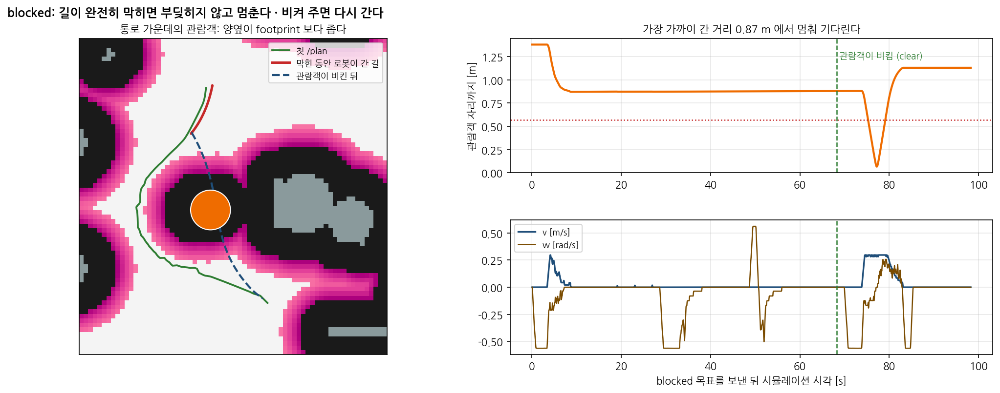{width=1000}

- 관람객 0.87 m 앞에서 멈춤 · 제자리에서 몇 번 돌며 다시 시도하지만 길이 없음
- 68 초 뒤 관람객이 비키자 costmap 에서 지워지고 통과

### 같은 순간의 MuJoCo 창 (blocked)

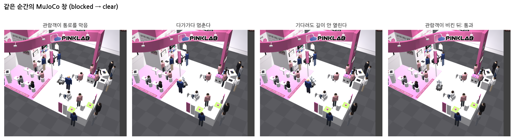{width=1000}

### 왜 못 지나가나

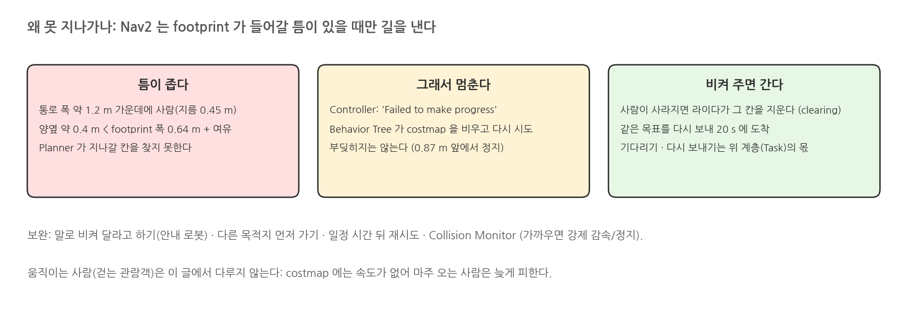{width=1000}

## 4. 코드와 설정

### 회피에 관여하는 파라미터

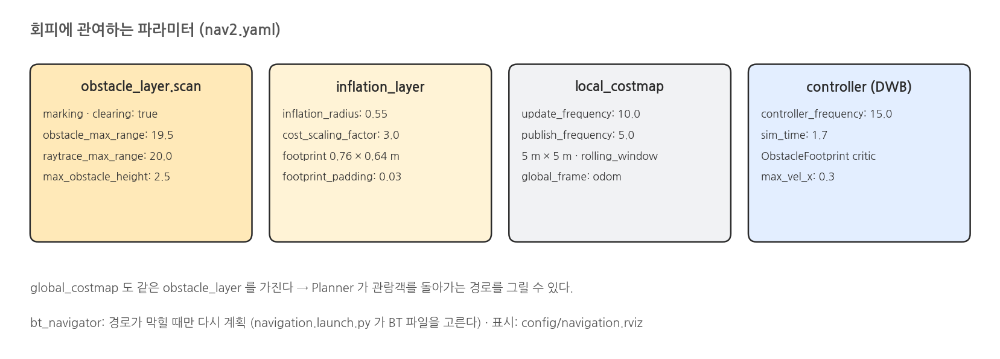{width=1000}

### 로봇을 따라다니는 5 m 창 - nav2.yaml local_costmap 발췌

```yaml
# src/mobile_openarm_navigation/config/nav2.yaml  (발췌)
local_costmap:
  local_costmap:
    ros__parameters:
      update_frequency: 10.0
      publish_frequency: 5.0
      global_frame: odom
      rolling_window: true
      width: 5
      height: 5
      resolution: 0.05
      plugins: [obstacle_layer, inflation_layer]
```

- 초당 10 번 갱신 · 5 번 발행 → 움직이는 사람이 0.1 초 안에 반영됨
- `global_frame: odom` + `rolling_window` → 지도가 아니라 지금 보이는 것만 담음
- 레이어 둘: 라이다로 칠하는 `obstacle_layer` · 둘레를 부풀리는 `inflation_layer`

### 라이다로 장애물 칠하고 지우기 - nav2.yaml local_costmap 발췌

```yaml
# src/mobile_openarm_navigation/config/nav2.yaml local_costmap (이어서)
      obstacle_layer:
        plugin: nav2_costmap_2d::ObstacleLayer
        observation_sources: scan
        scan:
          topic: /scan
          data_type: LaserScan
          clearing: true              # 레이가 지나간 칸을 비운다
          marking: true               # 레이가 멈춘 칸을 막힘으로
          raytrace_max_range: 20.0
          obstacle_max_range: 19.5
```

- `marking`: 광선이 멈춘 칸을 막힘으로 · `clearing`: 광선이 지나간 칸을 비움
- clearing 이 있어야 사람이 지나간 자리가 다시 빈 칸이 됨

### 장애물 부풀리기와 footprint - nav2.yaml local_costmap 발췌

```yaml
# src/mobile_openarm_navigation/config/nav2.yaml local_costmap (이어서)
      inflation_layer:
        plugin: nav2_costmap_2d::InflationLayer
        cost_scaling_factor: 3.0
        inflation_radius: 0.55
      footprint: '[[0.38,0.32],[0.38,-0.32],[-0.38,-0.32],[-0.38,0.32]]'
```

- 막힌 칸 둘레 55 cm 까지 비용 · 멀어질수록 낮아짐 (`cost_scaling_factor` 가 클수록 빨리)
- controller 는 `footprint` 사각형이 막힌 칸에 닿는 궤적을 버림

### 길이 막힐 때만 다시 계획 - navigation.launch.py 발췌

```python
# src/mobile_openarm_navigation/launch/navigation.launch.py  (발췌)
bt_xml = str(Path(get_package_share_directory("nav2_bt_navigator"))
             / "behavior_trees/navigate_w_recovery_and_replanning_only_if_path_becomes_invalid.xml")
for pkg, exe in [..., ("nav2_bt_navigator", "bt_navigator")]:
    actions.append(Node(
        package=pkg, executable=exe, name=exe,
        parameters=[params, {"default_nav_to_pose_bt_xml": bt_xml}] if exe == "bt_navigator" else [params],
    ))
```

- 기본 BT 는 1 초마다 전역 경로를 다시 계산 · 이 BT 는 경로가 막혔을 때만
- `bt_navigator` 에만 파라미터 하나를 더함 · 나머지 서버는 `nav2.yaml` 그대로

### Global · Local Costmap 표시 추가 - navigation.rviz 발췌

```yaml
# src/mobile_openarm_navigation/config/navigation.rviz  (발췌: 이번에 추가한 표시)
    - Class: rviz_default_plugins/Map
      Name: Global Costmap
      Topic: {Value: /global_costmap/costmap, Durability Policy: Transient Local}
      Color Scheme: costmap
      Alpha: 0.3
    - Class: rviz_default_plugins/Map
      Name: Local Costmap
      Topic: {Value: /local_costmap/costmap, Durability Policy: Transient Local}
      Color Scheme: costmap
      Alpha: 0.7
```

- costmap 도 지도와 같은 메시지 (OccupancyGrid) → RViz 의 Map 표시로 봄
- `Color Scheme: costmap` → 비용이 색으로 · `Alpha` 로 두 장을 겹쳐 봄

### Footprint · DWB 궤적 · Local Plan 표시 추가 - navigation.rviz 발췌

```yaml
# src/mobile_openarm_navigation/config/navigation.rviz (이어서)
    - Class: rviz_default_plugins/Polygon
      Name: Footprint
      Topic: {Value: /local_costmap/published_footprint}
    - Class: rviz_default_plugins/MarkerArray
      Name: DWB Trajectories
      Topic: {Value: /marker}
    - Class: rviz_default_plugins/Path
      Name: Local Plan
      Topic: {Value: /local_plan}
```

- Footprint = 로봇 외곽 · DWB Trajectories = controller 가 평가한 후보 궤적
- Local Plan = 그중 고른 궤적 (`/local_plan`)

### 관람객 세우고 목표 보내기 - avoid_scenario.py 발췌

```python
# docs/camp/avoid_scenario.py
SCENES = {"standing": ((6.30, -3.50), (7.43, -3.77, -1.15)),
          "blocked": ((5.35, -4.50), (5.98, -5.53, -1.55)),
          "clear": (OUTSIDE, (5.98, -5.53, -1.55))}
(px, py), (gx, gy, gyaw) = SCENES[a.mode]
n.place(px, py)
goal = NavigateToPose.Goal()
goal.pose.header.frame_id = "map"
goal.pose.pose.position.x, goal.pose.pose.position.y = gx, gy
handle = n.nav.send_goal_async(goal)
```

- `place`: `/warehouse/set_actor` 서비스의 `teleport` 로 관람객을 그 자리에 옮겨 세움
- 2 초 기다려 라이다가 관람객을 본 뒤 `/navigate_to_pose` 목표를 보냄
- `--timeout` 초 동안 결과가 없으면 목표를 취소 (blocked 에서 사용)

### 해 볼 것

- `avoid_scenario.py` 의 standing 자리를 (6.30, -3.20) 으로 바꿔 직선 경로 한가운데에 세우기 → 어느 쪽으로 돌아가는지 확인
- `nav2.yaml` 의 `inflation_radius` 를 0.8 로 키워 standing 다시 실행 → 관람객과의 최소 거리 비교
- RViz 에서 Local Costmap 만 켜고 관람객이 비킨 칸이 비워지는(clearing) 순간 관찰
- blocked 에서 `--timeout` 을 늘려 Nav2 가 스스로 ABORTED 를 낼 때까지 기다려 보기
