## 1. 문장 하나 → 단계 목록 → 차례로 실행

### RobotCommand 에서 RobotPlan 으로

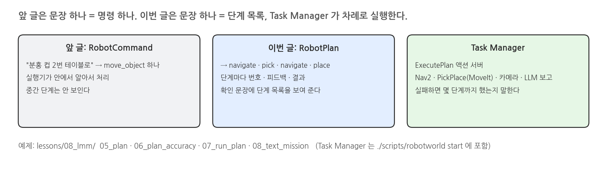{width=1000}

### RobotPlan

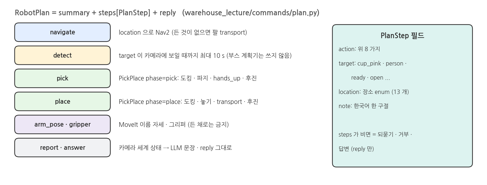{width=1000}

### 누가 무엇을 하나

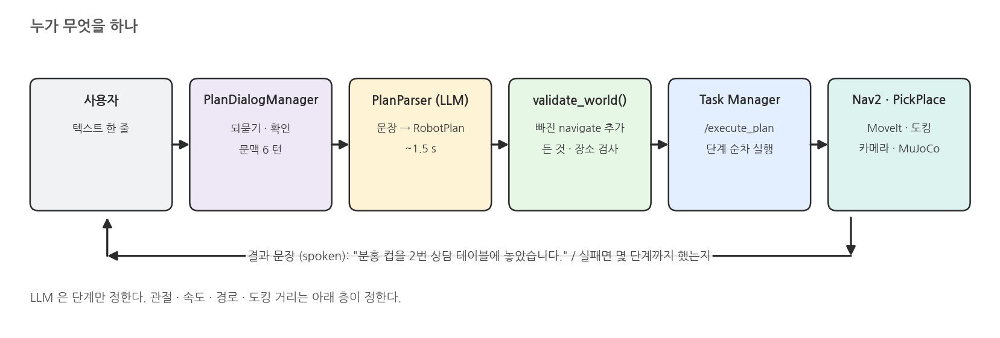{width=1000}

### 계획 검증: here 와 held

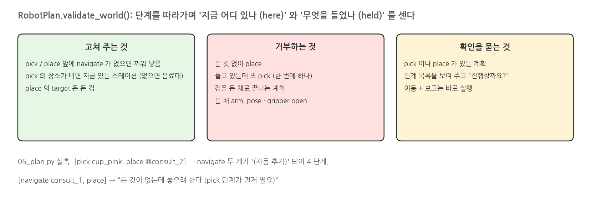{width=1000}

### 되묻기와 확인

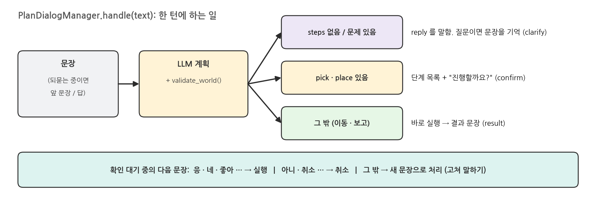{width=1000}

### 실패하면

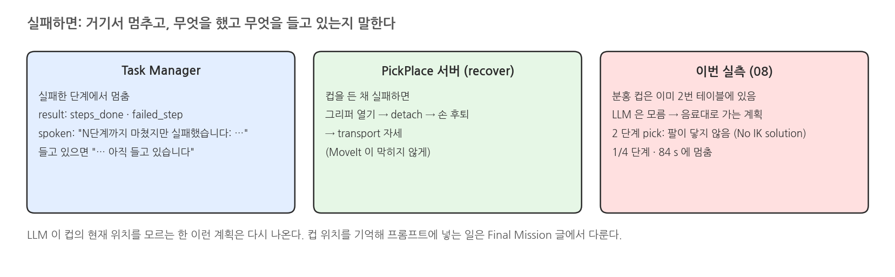{width=1000}

## 2. 실행: lessons/08_lmm 05 ~ 08

### 터미널: 05_plan (시뮬레이터 없이)

```bash
source /opt/ros/jazzy/setup.bash
source scripts/env.sh
./scripts/robotworld exec python lessons/08_lmm/05_plan.py
```

### 실행 결과: 05_plan

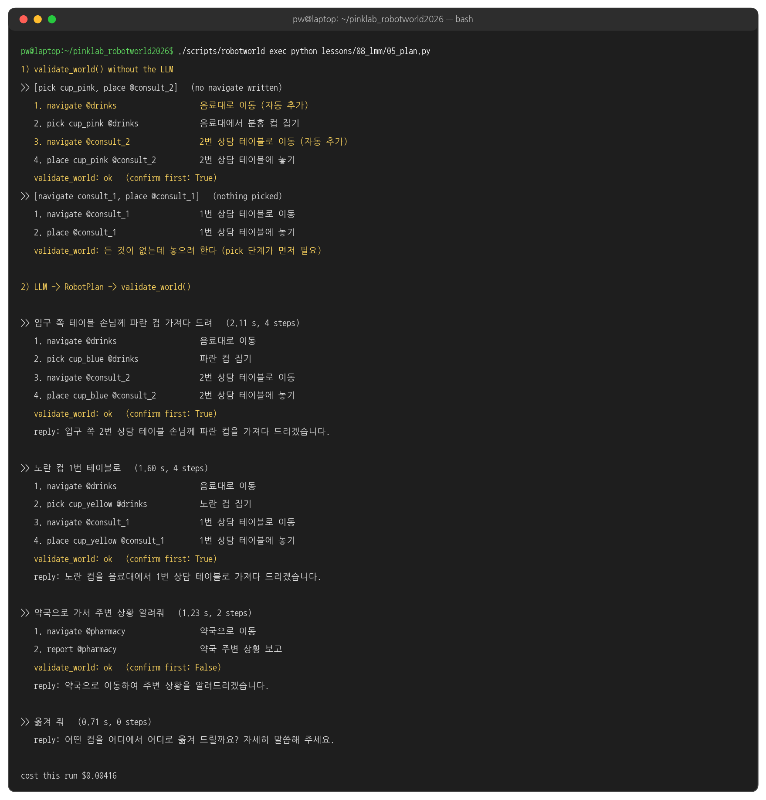{width=1000}

### 터미널: 06_plan_accuracy

```bash
./scripts/robotworld exec python lessons/08_lmm/06_plan_accuracy.py     # 20 문장
```

### 실행 결과: 06_plan_accuracy

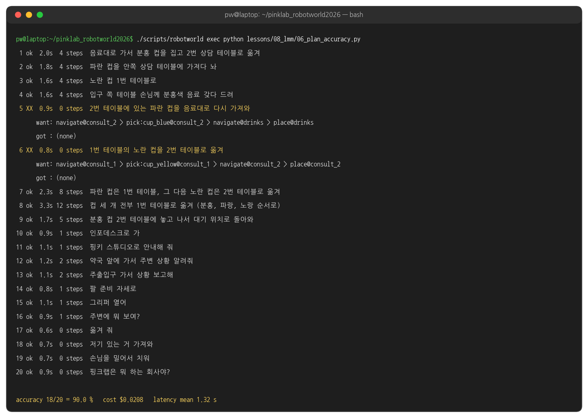{width=1000}

### 실행: 터미널 1 (start)

```bash
./scripts/robotworld start     # 시뮬레이터 · Nav2 · MoveIt · PickPlace 서버 · Task Manager 를 함께 띄운다
```

### 실행 결과: 시작 화면

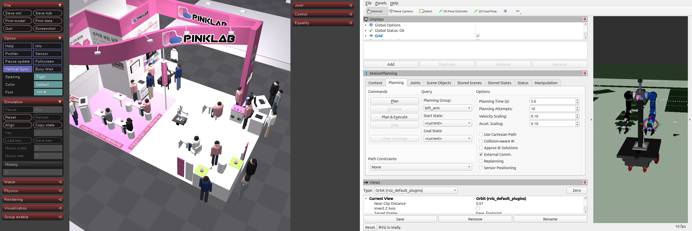{width=1000}

### 실행 결과: 터미널 1 의 Task Manager 줄

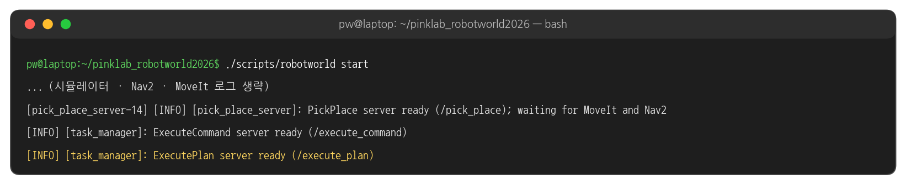{width=1000}

### 터미널 2: 08_text_mission

```bash
./scripts/robotworld exec python lessons/08_lmm/08_text_mission.py \
  --lines "손님께 음료 가져다 드려" "2번 테이블" "응"
```

### 실행 결과: 대화

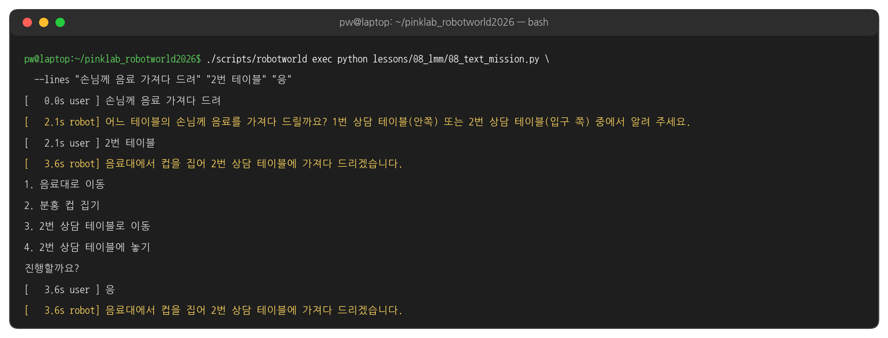{width=1000}

### 실행 결과: 실행

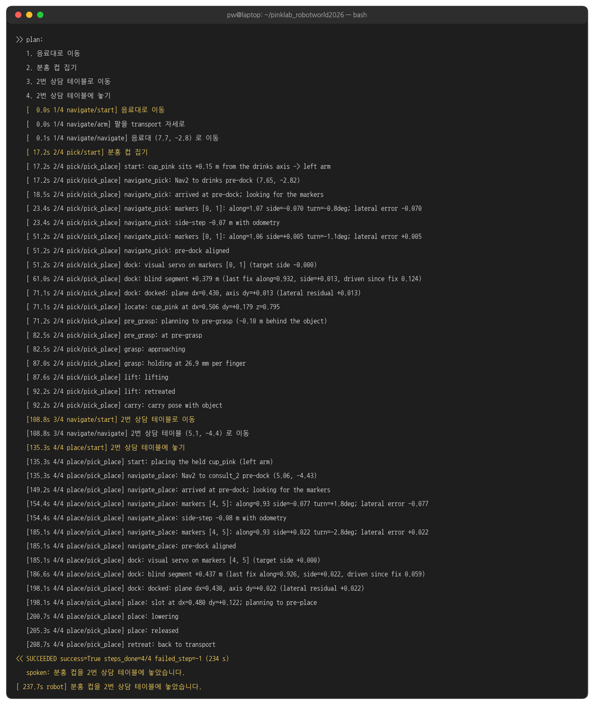{width=1000}

### 움직이는 그림: 문장 하나로 시작한 미션

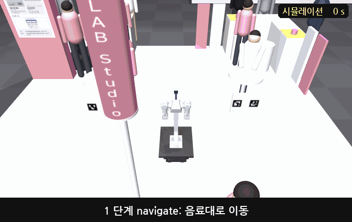{width=720}

### 시간 흐름

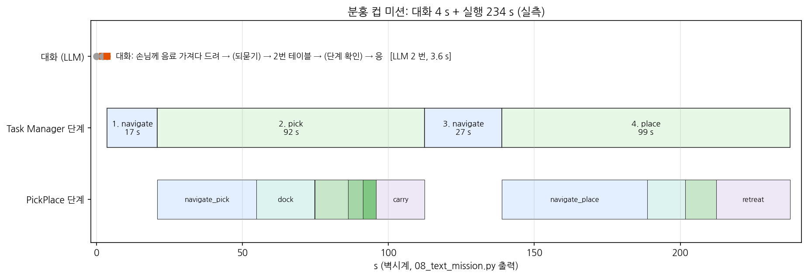{width=1000}

### 실행 결과: 실패 보고

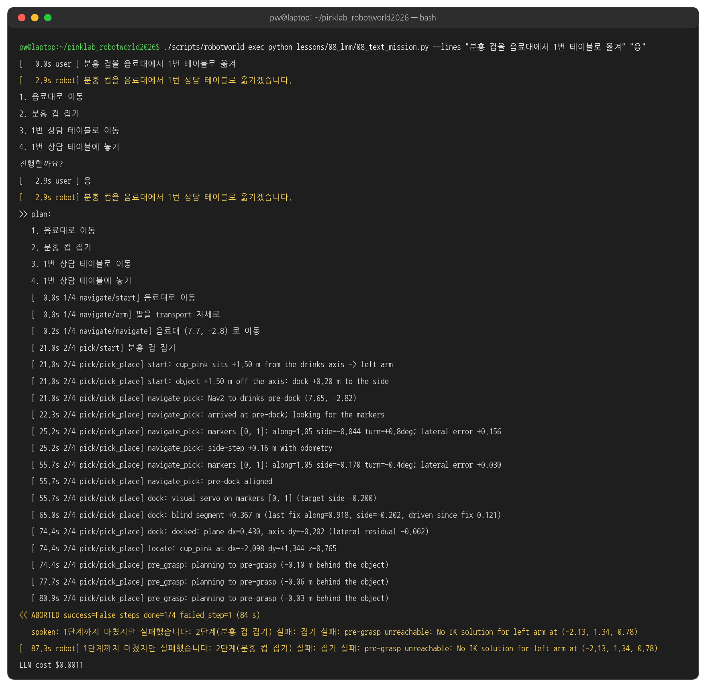{width=1000}

## 3. 코드와 설정

### 단계 종류 - plan.py StepAction 발췌

```python
# src/warehouse_lecture/warehouse_lecture/commands/plan.py
class StepAction(str, Enum):
    navigate = "navigate"      # Nav2 to a named place
    detect = "detect"          # confirm the target is visible to the cameras
    pick = "pick"              # dock at the table, grasp the object, lift to the carry pose
    place = "place"            # dock at the table, put the held object on a free slot
    arm_pose = "arm_pose"
    gripper = "gripper"
    report = "report"
    answer = "answer"
```

- LLM 이 고를 수 있는 단계는 이 8 가지뿐 → 관절 · 속도는 LLM 이 건드리지 않음
- `str, Enum` 이라 Structured Output 의 schema 와 ROS 메시지 문자열로 그대로 쓰임

### 한 단계 - plan.py PlanStep 발췌

```python
# src/warehouse_lecture/warehouse_lecture/commands/plan.py (이어서)
class PlanStep(BaseModel):
    action: StepAction
    target: str = Field("", description="pick/detect: cup_pink|cup_blue|cup_yellow|person. ...")
    location: Place = Field(Place.none, description="navigate: 목적지. pick: 컵이 있는 곳(음료대·상담 테이블). place: 놓을 곳")
    note: str = Field("", description="이 단계를 한국어 한 구절로 (예: 음료대로 이동)")
```

- `description` = LLM 이 읽는 필드 설명 · 앞 글의 structured command 와 같은 방식
- `location` 은 단계마다 뜻이 다름: navigate 목적지 · pick 컵이 있는 곳 · place 놓을 곳
- `note` = 확인 질문과 진행 알림에 그대로 나오는 한 구절

### 계획 전체 - plan.py RobotPlan 발췌

```python
# src/warehouse_lecture/warehouse_lecture/commands/plan.py (이어서)
class RobotPlan(BaseModel):
    summary: str = Field("", description="계획 전체를 한국어 한 문장으로")
    steps: List[PlanStep] = Field(default_factory=list, description="실행 순서대로. 되묻기·거부·단순 답변이면 비운다")
    reply: str = Field("", description="사용자에게 할 한 문장")
```

- `steps` 가 비어 있으면 실행 없이 `reply` 만 말함 (되묻기 · 거부 · 답변)
- `summary` 는 계획 설명 · `reply` 는 사용자에게 보여 줄 문장

### 현재 위치 따라가기 - plan.py validate_world 함수 발췌

```python
# src/warehouse_lecture/warehouse_lecture/commands/plan.py
fixed, held, here = [], None, None
for step in self.steps:
    a = step.action
    if a == StepAction.navigate:
        here = step.location                                       # 지금 어디 있나
```

- 계획을 실행하지 않고 머릿속으로 따라가 봄: `here` = 지금 위치 · `held` = 든 컵
- `fixed` = 고친 단계 목록 · 검사가 끝나면 `self.steps` 를 이것으로 바꿈

### pick 검사와 빠진 이동 끼워 넣기 - plan.py validate_world 함수 발췌

```python
# src/warehouse_lecture/warehouse_lecture/commands/plan.py validate_world (이어서)
    elif a == StepAction.pick:
        if step.location == Place.none:
            step.location = here if (here and here.value in STATIONS) else Place.drinks
        if held is not None:
            problems.append(f"이미 {TARGET_KO.get(held, held)}를 들고 있는데 또 집으려 한다")
        if here != step.location:                                  # 빠진 이동을 끼워 넣는다
            fixed.append(PlanStep(action=StepAction.navigate, location=step.location, note="... (자동 추가)"))
            here = step.location
        held = step.target                                         # 무엇을 들었나
```

- `location` 이 비면 지금 있는 스테이션, 스테이션이 아니면 음료대 (`drinks`) 로 채움
- `here` 와 스테이션이 다르면 navigate 단계를 앞에 자동 추가 → LLM 이 이동을 빠뜨려도 실행 가능
- 이미 든 채로 또 집는 계획은 고치지 않고 `problems` 에 기록

### place 검사와 끝 상태 확인 - plan.py validate_world 함수 발췌

```python
# src/warehouse_lecture/warehouse_lecture/commands/plan.py validate_world (이어서)
    elif a == StepAction.place:
        if step.location == Place.none:
            problems.append("어디에 놓을지 정해지지 않았다")
        if held is None:
            problems.append("든 것이 없는데 놓으려 한다 (pick 단계가 먼저 필요)")
        ...
        held = None
    fixed.append(step)
if held is not None:
    problems.append(f"계획이 {TARGET_KO.get(held, held)}를 든 채로 끝난다 (place 단계가 없다)")
self.steps = fixed
```

- pick 없이 place · 든 채로 끝나는 계획을 `problems` 로 돌려줌 (빈 목록 = 실행 가능)
- 놓을 곳에는 기본값이 없음 → 정해지지 않으면 문제로 돌려줌
- 생략한 `...` 부분: 스테이션 검사 · pick 과 같은 방식의 navigate 끼워 넣기

### 계획 프롬프트 - plan_parser.py 규칙 발췌

```python
# src/warehouse_lecture/warehouse_lecture/commands/plan_parser.py (SYSTEM 의 규칙 부분)
"""- 물·음료·커피·음료수·마실 것·컵은 모두 컵이다. 손님에게 마실 것을 가져다 달라는 말은 컵을 그 손님의 상담 테이블에 놓는 일이다.
- 컵을 옮기는 일은 항상 네 단계다: navigate(컵이 있는 곳) → pick(컵, location=그곳) → navigate(도착 테이블) → place(location=도착 테이블).
- 컵 색이 없으면 아래 표에서 그 테이블로 갈 수 있는 컵(음료대에 있는 것) 중 하나를 골라도 된다. 색을 말하면 그 색을 쓴다.
- 도착 테이블은 문장에서 정한다: 번호, '안쪽/입구 쪽', ... 정할 수 없으면 steps 를 비우고 reply 로 되묻는다.
- 여러 잔이면 컵마다 네 단계를 반복한다. 로봇은 한 번에 컵 하나만 들고, 한 컵은 한 번만 쓴다.
- 위험한 요청, 할 수 없는 일(부스 밖, 계단, 사람 들기)은 steps 를 비우고 reply 로 거부한다."""
```

- 운반 = 항상 네 단계라고 못 박아 둠 → 문장 표현이 달라도 같은 모양의 계획
- 컵 색은 골라도 되지만 도착 테이블은 추측 금지 → 정할 수 없으면 `steps` 를 비우고 되묻기
- "아래 표" = 컵 위치 표 (`WorldState`). 이번 글의 예제는 표 없이 부름 → 테이블에 있는 컵을 묻는 두 문장을 틀림 (06 결과)

### 서버 검증과 진행 알림 - task_manager.py execute_plan 함수 발췌

```python
# src/warehouse_lecture/warehouse_lecture/commands/task_manager.py
plan = RobotPlan.from_msg(handle.request)
problems = plan.validate_world()                                   # 서버에서 한 번 더
if problems:
    raise CommandError("; ".join(problems))
for i, step in enumerate(plan.steps):
    def feedback(phase, detail, _i=i, _step=step):
        handle.publish_feedback(ExecutePlan.Feedback(step=int(_i), total=int(total), action=_step.action.value, phase=phase, detail=detail))
        if handle.is_cancel_requested or self.cancel_flag:
            raise CommandError("취소됨")
```

- `validate_world` 를 서버에서 다시 실행 → 어떤 클라이언트가 보낸 계획이든 같은 검사
- `feedback` 한 번 = 액션 피드백 발행 + 취소 요청 확인 → 취소면 `CommandError` 로 중단
- `_i=i, _step=step` 기본 인자로 그 단계의 값을 고정 (콜백이 나중에 불려도 안 바뀜)

### 단계별 실행과 실패 단계 기록 - task_manager.py execute_plan 함수 발췌

```python
# src/warehouse_lecture/warehouse_lecture/commands/task_manager.py execute_plan (이어서)
    feedback("start", step.note or step.describe())
    try:
        said.append(self.run_step(step, feedback))                 # navigate · detect · pick · place · ...
    except CommandError as error:
        result.failed_step = int(i)
        raise CommandError(f"{i + 1}단계({step.note or step.describe()}) 실패: {error}")
    result.steps_done = int(i + 1)
...
```

- 한 단계라도 실패하면 뒤 단계는 실행하지 않고 멈춤
- `steps_done` = 끝난 단계 수 · `failed_step` = 실패한 단계 번호 (0 부터, 없으면 -1)

### 실패 문장 만들기 - task_manager.py execute_plan 함수 발췌

```python
# src/warehouse_lecture/warehouse_lecture/commands/task_manager.py execute_plan (이어서)
except CommandError as error:
    done = f"{result.steps_done}단계까지 마쳤지만 " if result.steps_done else ""
    result.spoken = f"{done}실패했습니다: {error}"
    if self.held:
        result.spoken += f" {TARGET_KO.get(self.held, self.held)}를 아직 들고 있습니다."
```

- `spoken` = 사용자에게 그대로 보여 줄 결과 문장 · 어디까지 했고 왜 멈췄는지 담음
- `self.held` 가 남아 있으면 컵을 아직 들고 있다고 덧붙임 → 다음 지령의 판단 근거

### pick: PickPlace 액션 호출 - task_manager.py step_pick 발췌

```python
# src/warehouse_lecture/warehouse_lecture/commands/task_manager.py (이어서)
def step_pick(self, step, feedback):
    self.arms_to("transport", feedback)
    goal = PickPlace.Goal(object=step.target, from_station=step.location.value, to_station="", arm="", phase="pick")
    r = self.call(self.pick, goal, 600.0, "PickPlace", self._skill_feedback(feedback))   # 앞 글의 /pick_place
    if r.status != GoalStatus.STATUS_SUCCEEDED or not r.result.success:
        raise CommandError(f"집기 실패: {r.result.message}")
    self.held = step.target
```

- 앞 글의 PickPlace 액션을 `phase="pick"` 로 호출 → 도킹 · 집기 · 들기까지만 실행
- `object` 에는 컵 이름 (`cup_pink`) 을 그대로 넘김
- 성공하면 `self.held` 에 기록 → 뒤의 navigate · place 단계가 이 값을 봄

### 확인 대기와 계획 만들기 - dialog.py PlanDialogManager.handle 함수

```python
# src/warehouse_lecture/warehouse_lecture/commands/dialog.py
def handle(self, text):
    if self.pending is not None:
        return self._answer_confirmation(text)                     # 응 → 실행, 아니 → 취소, 그 밖 → 새 문장
    utterance = f"{self.clarifying} / {text}" if self.clarifying else text   # "손님께 음료 가져다 드려 / 2번 테이블"
    plan = self.parser.parse(utterance, context=self.context)
    problems = plan.validate_world()
    self._remember(utterance, plan)
```

- `pending` 이 있으면 이번 문장은 새 지령이 아니라 확인 질문의 대답으로 처리
- 되묻던 중이면 앞 문장과 `/` 로 이어 붙여 다시 계획 → "2번 테이블" 만 말해도 이어짐
- `_remember`: 문장과 계획을 `context` 에 쌓아 다음 LLM 호출에 함께 보냄

### 되묻기 · 확인 · 실행 분기 - dialog.py PlanDialogManager.handle 함수

```python
# src/warehouse_lecture/warehouse_lecture/commands/dialog.py handle (이어서)
    if not plan.steps or problems:
        reply = plan.reply or ("; ".join(problems) if problems else "")
        asks = bool(problems) or any(k in reply for k in ("?", "까요", "알려", "말씀", "어떤", "어디", "무엇", "무슨", "구체적"))
        self.clarifying = utterance if asks else None
        return self._say("clarify" if self.clarifying else "answer", reply, plan)
    self.clarifying = None
    if self.confirm and plan.needs_confirmation():                 # pick / place 가 있으면
        self.pending = plan
        return self._say("confirm", f"{plan.reply or plan.summary}\n{plan.describe()}\n진행할까요?", plan)
    return self._execute(plan, text)
```

- 단계가 없거나 문제가 있으면 실행 없이 답만 함 · 질문이면 `clarifying` 에 문장을 남김
- `needs_confirmation`: pick · place 가 든 계획만 번호 목록을 보여 주고 "진행할까요?"
- 이동 · 보고뿐인 계획은 확인 없이 바로 `_execute`

### 액션 보내기 - 07_run_plan.py 발췌

```python
# lessons/08_lmm/07_run_plan.py
def on_fb(m):
    f = m.feedback                                                 # step · total · action · phase · detail
    print(f"   [{time.monotonic() - t0:5.1f}s {f.step + 1}/{f.total} {f.action}/{f.phase}] {f.detail}", flush=True)


future = self.client.send_goal_async(plan.to_msg(utterance=utterance), feedback_callback=on_fb)   # /execute_plan
...
r = result.result().result
print(f"<< {status} success={r.success} steps_done={r.steps_done}/{len(plan.steps)} failed_step={r.failed_step}")
print(f"   spoken: {r.spoken}")
```

- `/execute_plan` 액션 클라이언트 · `to_msg` 가 `RobotPlan` 을 goal 메시지로 바꿈
- 피드백의 `step` 은 0 부터 → 출력할 때 `+ 1`
- 결과의 `steps_done` · `failed_step` · `spoken` 으로 어디서 멈췄는지 확인

### 목표와 결과 - ExecutePlan.action

```text
# src/warehouse_interfaces/action/ExecutePlan.action
string summary           # 계획 요약 한 문장
PlanStep[] steps
string utterance         # 원문
---
bool success
string message
string spoken            # 사용자에게 보여 줄 결과 문장
int32 steps_done         # 성공한 단계 수
int32 failed_step        # 실패한 단계 번호 (0 부터), 없으면 -1
```

### 피드백 - ExecutePlan.action

```text
# src/warehouse_interfaces/action/ExecutePlan.action (이어서)
---
int32 step               # 현재 단계 (0 부터)
int32 total
string action
string phase
string detail
```

### 해 볼 것

- `07_run_plan.py pick:cup_blue@drinks place:@consult_1` (navigate 없이 보내기) → Task Manager 가 navigate 를 끼워 넣는지 보기
- `08_text_mission.py` 에 "파란 컵은 1번 테이블, 노란 컵은 2번 테이블로" → 8 단계 목록을 보고 "아니" 로 취소
- `06_plan_accuracy.py` 에서 틀린 두 문장의 `reply` 를 `artifacts/lessons/08_plan_accuracy.json` 에서 읽어 보기 (컵 위치를 모르는 LLM 의 답)
