## 0. 시작 전에

### 지원 환경 · 필요한 것 · 소요 시간

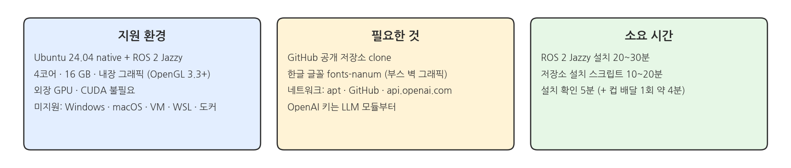{width=1000}

- 지원 환경: Ubuntu 24.04 native + ROS 2 Jazzy · 4코어 · 16 GB · 내장 그래픽이면 충분
- 저장소: https://github.com/PinkWink/pinklab_robotworld2026

## 1. 환경 설정

### 설치 흐름

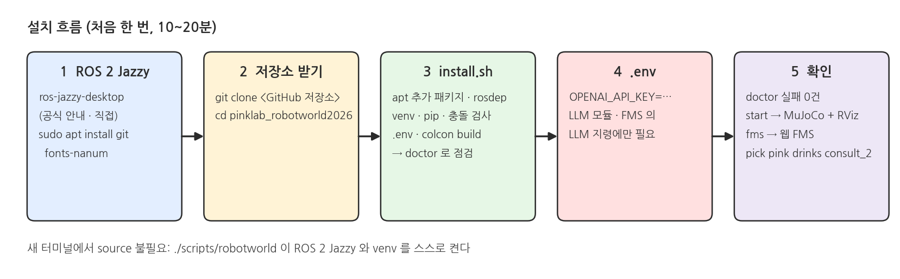{width=1000}

- 다섯 단계를 순서대로 1회만 수행 (10~20분 소요)
- 새 터미널에서 source 불필요 — `./scripts/robotworld ...`이 ROS 2 Jazzy와 venv를 스스로 활성화
- 설치 후 `./scripts/robotworld doctor`로 점검 → ❌ 0건이면 준비 완료

### ① ROS 2 Jazzy + 추가 패키지

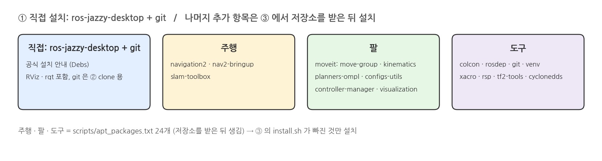{width=1000}

### ① ROS 2 Jazzy + 추가 패키지 설치 명령

- 공식 안내에 따라 `ros-jazzy-desktop` 설치: https://docs.ros.org/en/jazzy/Installation/Ubuntu-Install-Debs.html
- 이어서 git 과 한글 글꼴 설치 (② 저장소 받기 · 부스 벽 그래픽의 한글에 필요)
- 추가 apt 패키지(Nav2 · MoveIt · SLAM 등 24개)는 ③ 에서 저장소를 받은 뒤 설치, `rosdep init/update`는 설치 스크립트가 자동 처리

```bash
sudo apt install git fonts-nanum
```

### ② 저장소 받기 → ③ 설치 스크립트

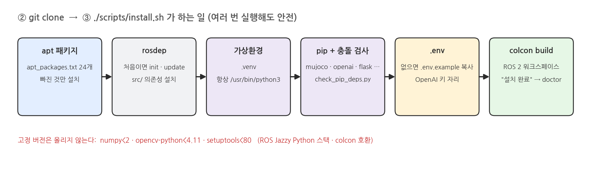{width=1000}

### ③ 설치 스크립트

```bash
cd ~
git clone https://github.com/PinkWink/pinklab_robotworld2026.git
cd pinklab_robotworld2026
./scripts/install.sh                # 빠진 apt 패키지가 있으면 sudo 비밀번호를 묻는다
./scripts/robotworld doctor     # 환경 점검
```

- 수행 순서: apt 패키지 → rosdep → 가상환경 → pip → 충돌 검사 → `.env` → `colcon build`
- 마지막에 "설치 완료" 출력 시 성공

### ③ 설치 스크립트: 실행 결과

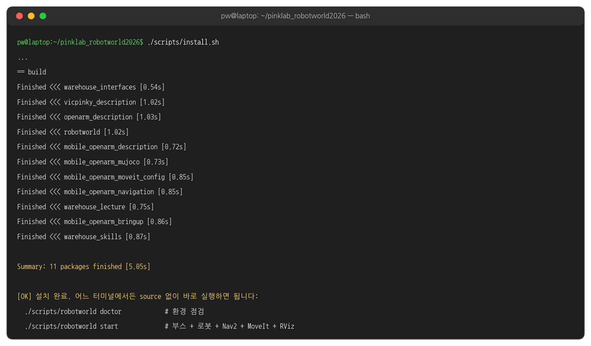{width=1000}

### doctor 실행 결과

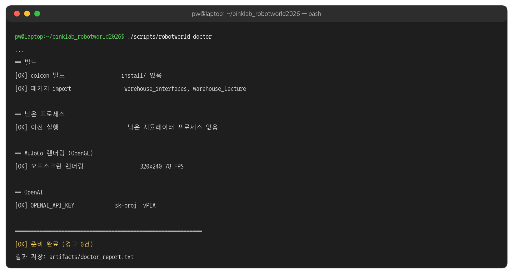{width=1000}

### ③ 설치 스크립트: 주의할 점

- 여러 번 실행해도 안전 — 네트워크 끊김 등으로 멈추면 다시 실행
- conda base가 켜진 터미널도 가능 (venv는 항상 시스템 Python으로 생성)
- 충돌 검사의 `WARN`은 무시 (이 저장소와 무관한 apt 패키지끼리의 충돌), `ERROR`는 `requirements.txt` 의 고정 버전 확인
- 고정 버전(`numpy<2`, `opencv-python<4.11`, `setuptools<80`) 업그레이드 금지 — ROS Jazzy · colcon 호환

### install.sh 가 하는 일

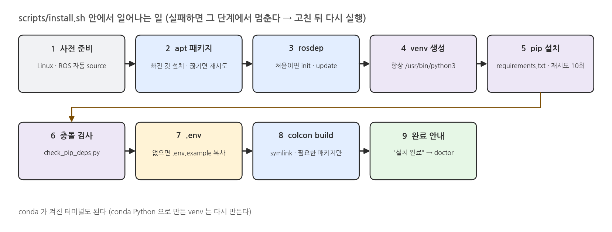{width=1000}

### OpenAI API 키 받는 법

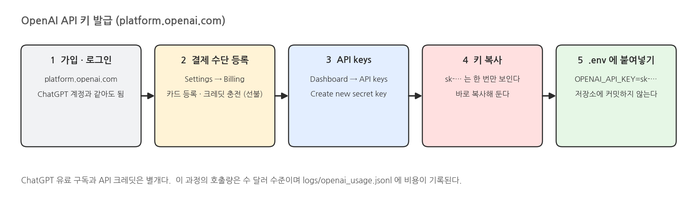{width=1000}

### OpenAI API 키 받는 법: 절차와 링크

- 가입 · 로그인: https://platform.openai.com (ChatGPT 계정 그대로 사용 가능)
- 결제 수단 등록: https://platform.openai.com/settings/organization/billing/overview 에서 카드 등록 후 크레딧 충전
- 키 생성: https://platform.openai.com/api-keys 에서 "Create new secret key" 클릭
- `sk-`로 시작하는 키는 생성 시 한 번만 표시 → 즉시 복사해 보관
- 복사한 키를 `.env`의 `OPENAI_API_KEY=`에 붙여넣기 · 저장소 커밋 금지
- ChatGPT 유료 구독과 API 크레딧은 별개 · 이 과정의 호출량은 수 달러 수준

### ④ OpenAI 키

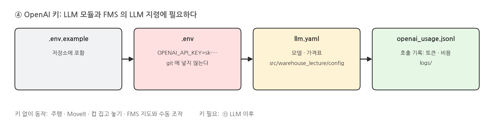{width=1000}

### ④ OpenAI 키 설정 명령

```bash
cd ~/pinklab_robotworld2026
gnome-text-editor .env    # OPENAI_API_KEY=sk-... 자리에 본인 키 붙여넣기
```

- `.env` 는 설치 스크립트가 `.env.example` 을 복사해 만들어 둠 · 키는 위 "OpenAI API 키 받는 법"대로 직접 발급
- LLM 모듈과 웹 FMS 의 LLM 지령에 필요 · 주행 · MoveIt · 컵 집고 놓기는 키 없이 동작
- 모델 · 가격표: `src/warehouse_lecture/config/llm.yaml` · 호출 기록: `logs/openai_usage.jsonl`

### ros2 명령을 직접 칠 때 (env.sh)

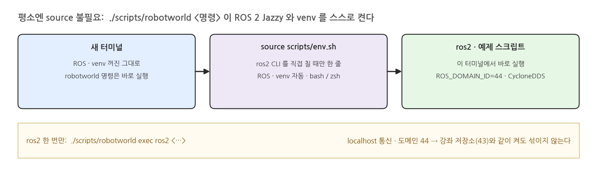{width=1000}

### ROS 2를 실행할 때 터미널에서 환경을 활성화하는 이유

```bash
source /opt/ros/jazzy/setup.bash             # ① ROS 2 본체: ros2 명령 · 기본 패키지
source .venv/bin/activate                    # ② Python 가상환경: mujoco 등
source install/local_setup.bash              # ③ 내 워크스페이스: 직접 빌드한 패키지
```

- 새 터미널은 ROS 2를 모르는 상태로 열림 → source 없이는 `ros2: command not found` 또는 패키지를 찾지 못함
- source 는 그 터미널 하나에만 적용 → 터미널(탭)을 새로 열 때마다 다시 실행
- 이 과정은 위 세 줄과 통신 설정을 `source scripts/env.sh` 한 줄로 묶음

### 참조 영상: 또. 다시. 강조하는 bashrc

{width=480}

- 영상: [ROS2 1. 또. 다시. 강조하는 bashrc (핑크랩 PinkLAB, 약 19분)](https://www.youtube.com/watch?v=NLZwZaMEhxA&list=PL0xYz_4oqpvjyrCQKB1eiAbZG-bCDe98_&index=3)
- "무작정 따라하는 ROS2 - 실전과정"의 Intro · ROS 2 Humble / Jazzy 기준
- 요약: 터미널을 열 때마다 필요한 ROS 2 환경 설정을 `~/.bashrc`에 정리해 두는 방법

### ros2 CLI를 직접 쓰는 터미널에서

```bash
cd ~/pinklab_robotworld2026
source scripts/env.sh      # ROS 2 Jazzy · venv 가 꺼져 있으면 자동으로 켠다 (bash · zsh)
```

- `env.sh` 설정 항목: 가상환경 + install 환경 + `ROS_DOMAIN_ID=44` + CycloneDDS(localhost)
- source 안 한 터미널에서도 `./scripts/robotworld <명령>` 바로 사용 가능 (ROS · venv 자동 활성화, ros2 CLI는 `exec ros2 ...`)
- localhost 통신 · 도메인 44 라서 강좌 저장소(도메인 43)와 한 PC 에서 같이 켜도 토픽 혼선 없음

### env.sh 가 하는 일

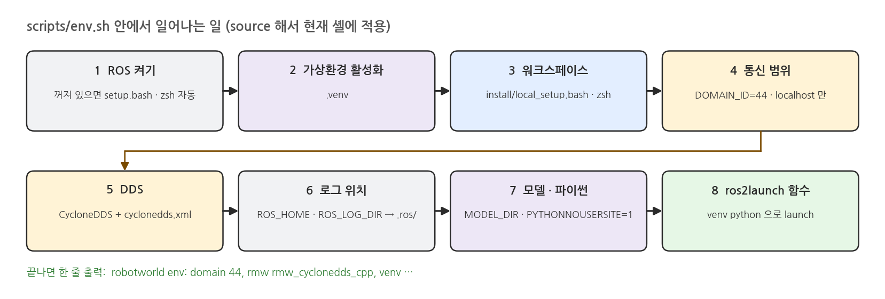{width=1000}

### env.sh 실행 결과

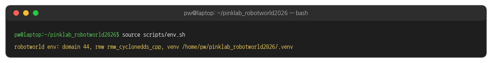{width=1000}

### ⑤ 설치 확인

```bash
cd ~/pinklab_robotworld2026
./scripts/robotworld doctor          # 약 10초
./scripts/robotworld doctor --api    # .env 에 키를 넣은 뒤: OpenAI API 실제 호출까지 확인
```

- OS · CPU · RAM · 디스크, apt 패키지, venv · Python 패키지 버전, 빌드, MuJoCo 렌더링 속도, OpenAI 키를 ✅/⚠️/❌로 표시
- ❌ 0건이면 준비 완료 · 결과는 `artifacts/doctor_report.txt` 에도 저장

### ⑤ 설치 확인: 시뮬레이터 실행

```bash
cd ~/pinklab_robotworld2026
./scripts/robotworld start
```

- 실행 결과 (왼쪽: MuJoCo 창, 오른쪽: RViz2)

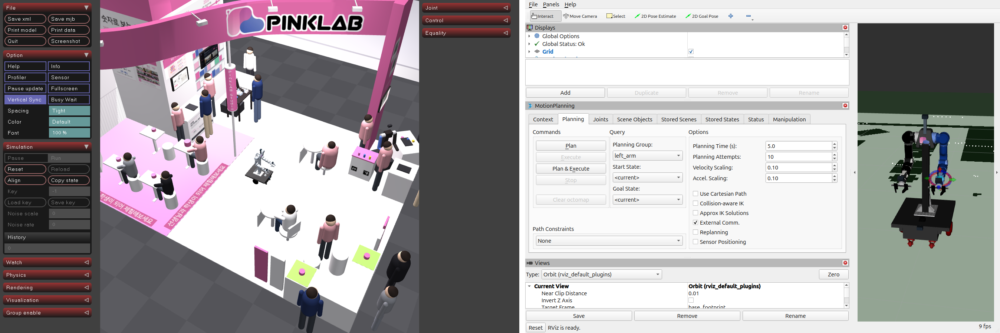{width=1000}

## 2. 실행 구조

### 터미널 두 개

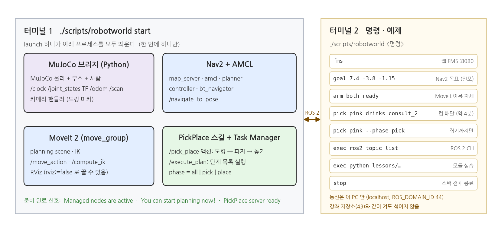{width=1000}

- 터미널 1: `./scripts/robotworld start` — launch 하나로 모든 프로세스 실행
- 터미널 2: 명령과 실습 — `./scripts/robotworld <명령>` (ros2 를 직접 칠 때만 `source scripts/env.sh`)

### wrapper 명령

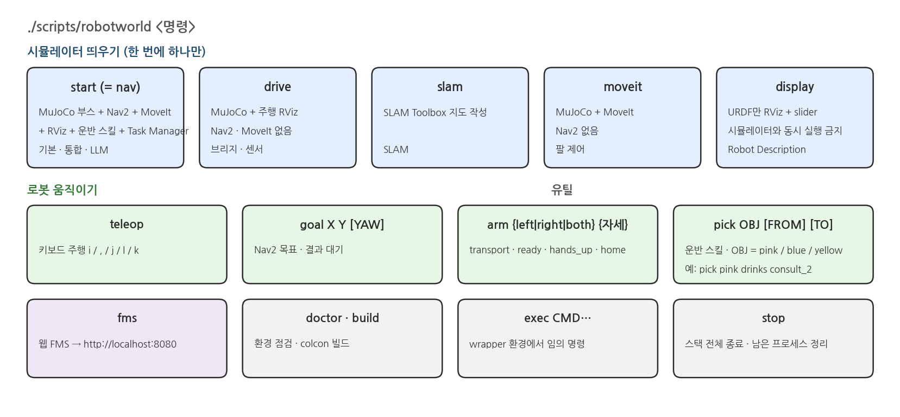{width=1000}

- 시뮬레이터는 한 번에 하나만 실행 (lock 파일로 중복 차단)
- 종료는 `./scripts/robotworld stop` (남은 프로세스까지 정리) · 웹 FMS 는 `./scripts/robotworld fms` → http://localhost:8080

### launch 인자

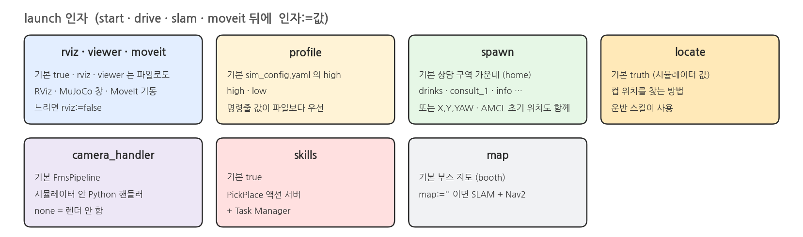{width=1000}

- `start`, `drive`, `slam`, `moveit` 뒤에 `인자:=값` 형식으로 추가
- 기본값은 작업 공간 맨 위 `sim_config.yaml` (`profile: high`) · 명령줄 인자가 파일보다 우선
- 느리면 7절 'PC 사양에 맞추기' 참고

### description

- 시뮬레이터 없이 로봇 모델(URDF)만 RViz2에 표시 — Joint · Link · TF 트리 구조 확인용
- 슬라이더 창에서 관절 조작 시 RViz2의 로봇과 TF가 함께 움직임
- 시뮬레이터 실행 중에는 사용 금지 (둘 다 `/joint_states` · `/tf` 발행)

```bash
cd ~/pinklab_robotworld2026
source /opt/ros/jazzy/setup.bash
source scripts/env.sh
ros2 launch mobile_openarm_description display.launch.py              # RViz2 + 관절 슬라이더
ros2 launch mobile_openarm_description display.launch.py gui:=false   # 슬라이더 없이
# 같은 것: ./scripts/robotworld display
```

### 실행결과

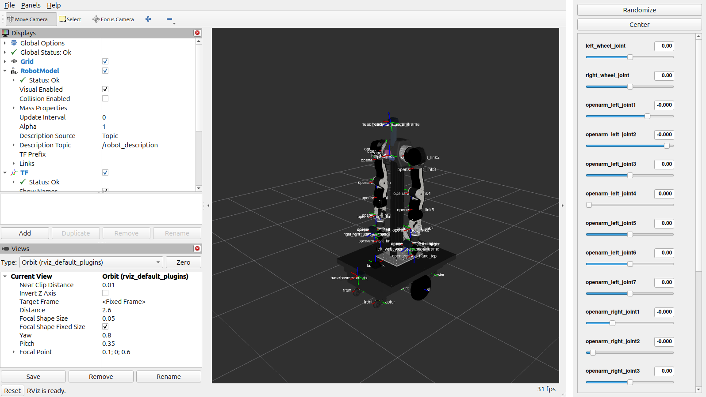{width=1000}

## 3. 부스와 로봇

### 부스 배치도

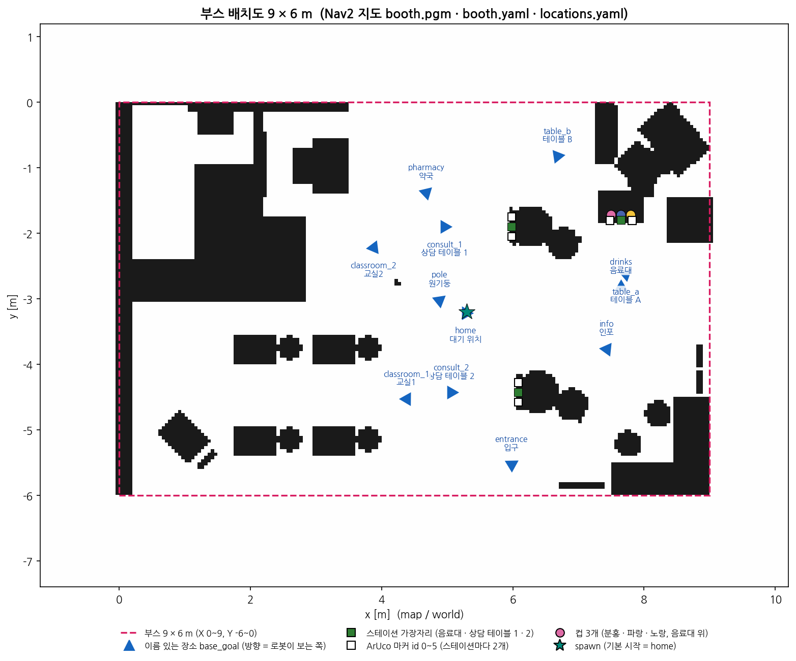{width=1000}

- 로보월드 2026 핑크랩 부스 9 × 6 m (X 0~9, Y −6~0) · 출처: Nav2 지도 `booth.pgm` · `booth.yaml` · `locations.yaml`
- 별 = 기본 시작 위치(home) · 삼각형 = 이름 있는 장소의 `base_goal`
- 좌표: MuJoCo X = 설계 x / 100, Y = −설계 z / 100

### 장소 이름 (locations.yaml)

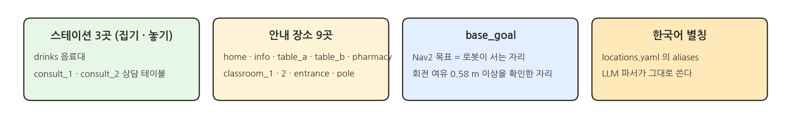{width=1000}

- 스테이션 3곳(집기 · 놓기): `drinks` 음료대 · `consult_1` · `consult_2` 상담 테이블
- 안내 장소 9곳: `home` · `info` · `table_a` · `table_b` · `pharmacy` · `classroom_1` · `classroom_2` · `entrance` · `pole`
- 한국어 별칭은 LLM 파서가 그대로 사용

### 컵 · 음료대 · 마커

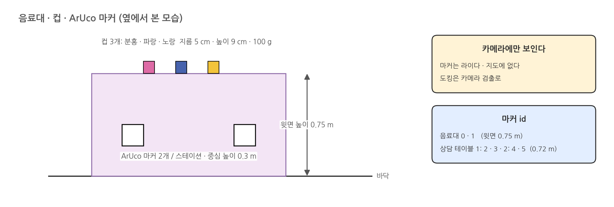{width=1000}

### 부스의 사람과 전시물 (scenario.yaml)

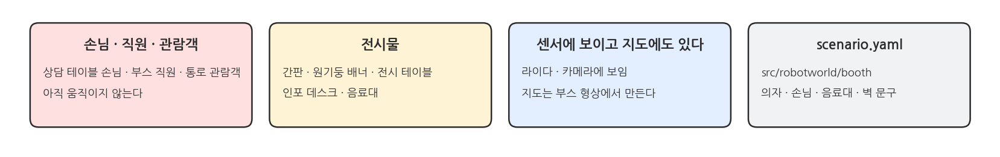{width=1000}

## 4. ROS 2 인터페이스

### 인터페이스 한눈에

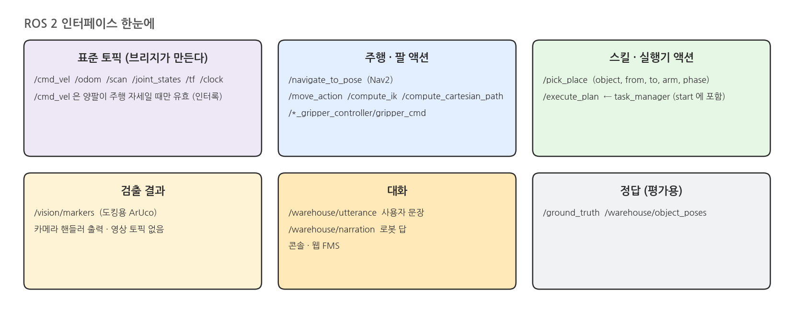{width=1000}

## 5. 자주 수정하는 설정

### 설정 파일 지도 (src/ 아래)

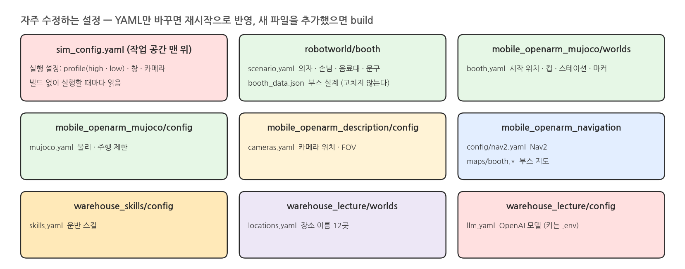{width=1000}

## 6. 문제 해결

### 실행 환경 문제

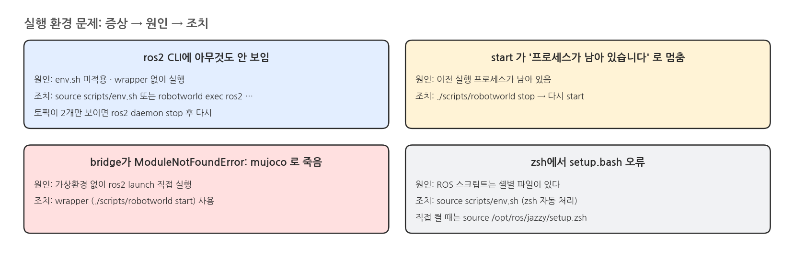{width=1000}

### 동작 · 성능 · 키 문제

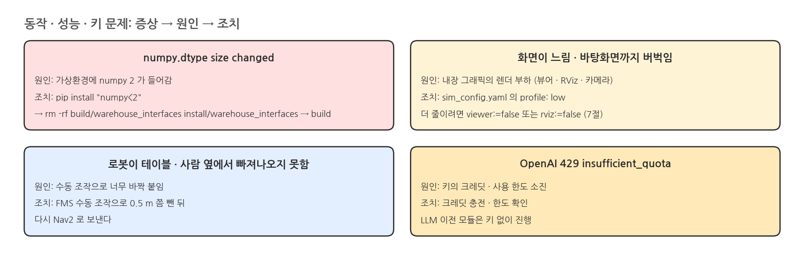{width=1000}

### 설치 문제

- **무엇이 문제인지 모를 때**: `./scripts/robotworld doctor`의 ❌ 줄부터 해결
- **pip 의존성 충돌이 있습니다**: `WARN`만 있으면 무시 · `ERROR` 줄은 `requirements.txt` 의 고정 버전 확인
- **apt 다운로드 실패**: 네트워크 끊김 → `./scripts/install.sh` 다시 실행 (받은 패키지는 보존)
- **이미 받은 저장소를 최신으로**: 저장소 폴더에서 `git pull` 후 설치 스크립트 실행

## 7. PC 사양에 맞추기

### 두 단계: high · low

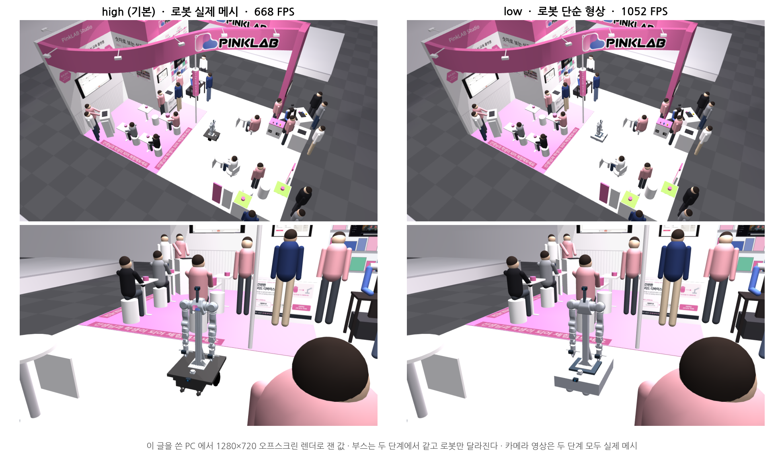{width=1000}

- 무거운 부분은 부스가 아니라 로봇: 로봇 메시 약 270만 삼각형 · 부스는 수천 개
- high(기본값)는 지금까지의 설정 · low 는 뷰어의 로봇을 충돌 형상(삼각형 약 1/22)으로 그리고 카메라 그림자를 끔
- 물리 · 라이다 · 도킹 마커 인식은 두 단계에서 같음

### 설정 파일 sim_config.yaml

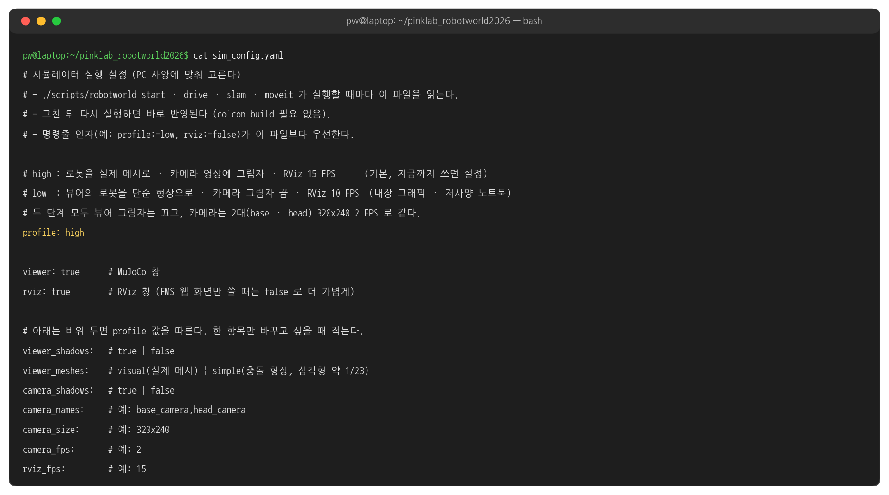{width=1000}

- `./scripts/robotworld` 가 실행할 때마다 읽음 → 고친 뒤 빌드 없이 다시 실행
- 우선순위: 명령줄 인자(`rviz:=false`) > `sim_config.yaml` > profile 기본값
- 실행 첫머리 `[sim_config]` 줄에 실제로 적용된 값이 표시됨

### sim_config.yaml 바꿔 실행하기

```bash
cd ~/pinklab_robotworld2026
sed -i 's/^profile: high/profile: low/' sim_config.yaml     # 편집기로 고쳐도 같음
./scripts/robotworld start
./scripts/robotworld start profile:=high rviz:=false         # 명령줄 인자가 파일보다 우선
```

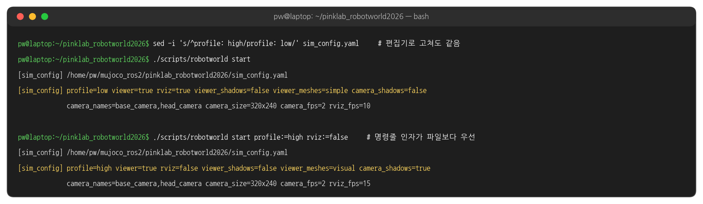{width=1000}

### 더 가볍게 실행하기

```bash
cd ~/pinklab_robotworld2026
./scripts/robotworld start profile:=low       # 이번 실행만 low
./scripts/robotworld start viewer:=false      # MuJoCo 창 없이 RViz만
./scripts/robotworld start rviz:=false        # RViz 없이 MuJoCo 창만 (지도는 웹 FMS 로)
./scripts/robotworld drive                    # MoveIt · Nav2 없이 주행만
```

### 더 가볍게 실행하기: MuJoCo 창 없이 실행한 화면

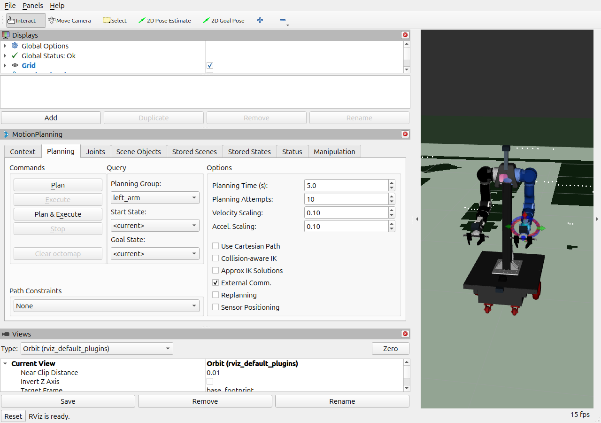{width=1000}
